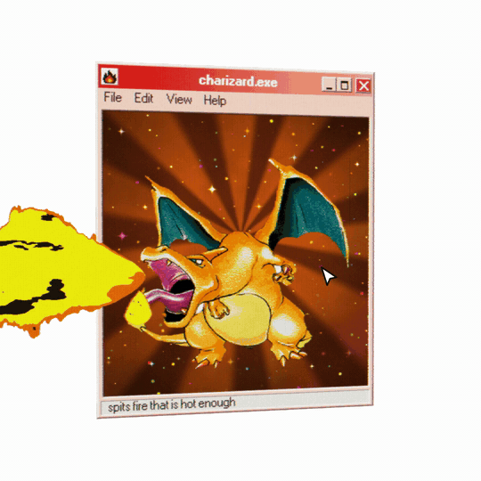

# holographic-card

A Claude skill and a small WebGL2 + TypeScript library for interactive 3D holographic
Pokémon in a Windows 98 window. The window tilts with the pointer, the foil sparkles
as it moves, and pressing makes the Pokémon turn its head and breathe fire, all behind
a CRT screen.



## What's in the repo

| | |
|---|---|
| `SKILL.md`, `references/` | The skill: workflow, the rules that make it work, and guides for the art, the look and the motion. |
| `lib/` | The component: `holo.ts` (setup, motion, input), `shaders.ts` (the scene and CRT passes), `chrome.ts` (the Win98 frame), `types.ts` (the config). No runtime dependencies. |
| `examples/charizard/` | `charizard.exe`: the config, the page, and the recipe for cutting Charizard out of the card. |
| `scripts/cutout.py` | Downloads a card scan and cuts the Pokémon out of it. |

## Install the skill

For Claude Code, clone it into your skills folder:

```sh
git clone https://github.com/JDhruv14/holographic-card ~/.claude/skills/holographic-card
```

or into `.claude/skills/` inside a single project. Then ask for what you want, for example:

- "Make a holographic Venusaur window like the Charizard one."
- "Copy this clip exactly: a holo card in a Win98 window." (attach or link the clip)
- "Add a Blastoise whose cannons shoot water instead of fire."

Claude reads `SKILL.md`, cuts the Pokémon out of a real card scan, writes its config,
and shows you one window to approve before going further.

## Run the example

Requires Node 22 or newer and [uv](https://docs.astral.sh/uv/) for the cutout.

The card art isn't in the repo. Cut it out of the card scan first; this downloads the
scan from pokemontcg.io:

```sh
npm install
npm run cutout examples/charizard/card.json
npm run dev        # http://localhost:5173
```

Move the pointer over the window to tilt it. Press, or hold Space, to breathe fire.
`?t=3` freezes the frame at 3 seconds; `?debug` exposes `holo` in the console so you
can call `holo.step(1/30)` to advance one frame at a time.

```sh
npm run typecheck
npm run build
```

## Using the library

```ts
import { createHolo } from './lib/holo.ts';
import { charizard } from './examples/charizard/charizard.ts';

const holo = await createHolo(document.querySelector('canvas')!, charizard);
holo.camera(1.22, 0.6);   // zoom in 22%, most of the way toward the head
```

The canvas fills whatever box you give it; the window keeps its proportions and sits
in the middle with white space around it. A config describes one Pokémon: the window's
title, status line, icon and colours, where the figure sits, which part of it turns
with the head, the backdrop, and the breath. Positions on the figure are pixels of the
cut-out image. `lib/types.ts` documents every field, and
[`references/art.md`](references/art.md) shows how to measure them.

Rendering is two passes. The first casts a ray per pixel onto the tilted window and
draws the frame, the foil backdrop, the figure (with its head turned by inverting the
rotation in the shader) and the breath into a texture. The second draws that texture
through a CRT: aperture grille, scanlines, fringing and bloom over the window and the
breath, plain white everywhere else.

## Credits

Pokémon and the card art belong to Nintendo, Creatures Inc. and GAME FREAK; the art is
downloaded from [pokemontcg.io](https://pokemontcg.io) when you run the cutout and
isn't distributed here. The window fonts are MS Sans Serif as converted by
[98.css](https://github.com/jdan/98.css) (MIT).

## License

MIT, for the code in this repository.
